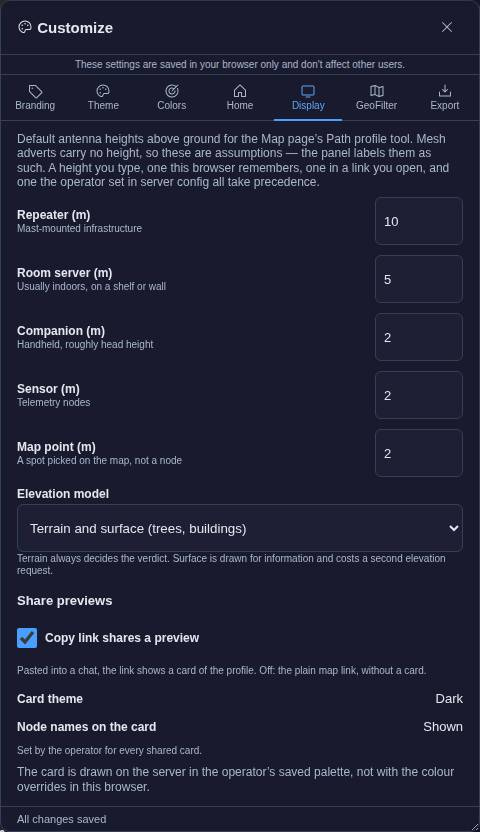
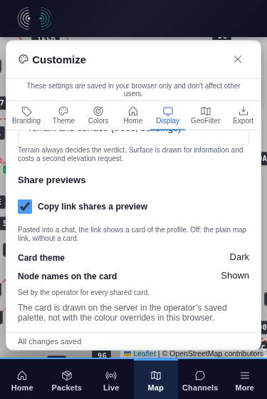

# Share previews for path profiles

When sharing is on, the Path profile's **Copy link** button on the Map hands
out a `/p?profile=…` link instead of `#/map?profile=…`. Pasted into Discord,
Facebook, Slack or a similar chat, that link shows a preview card of the
profile. Opened in a browser, it goes straight to the same profile on the Map.

Sharing is off by default (#727).

## What the card shows

The card is a 1200×630 PNG drawn on the server, `GET /api/terrain/profile.png`.
The `/p` page names it as its `og:image`. The card shows:

- both endpoints. A node is shown by name, and a free map point by its
  coordinates. With `card.names` set to `false`, nodes show as "Node A" and
  "Node B". A hidden, blacklisted or unpositioned node is never named: the
  profile treats it as "not found";
- the chart, drawn as in the panel: terrain, surface, line of sight and
  Fresnel zone;
- the verdict, in the panel's words;
- the antenna heights, with the "assumed" caveat where no one set them;
- the DHM CC BY 4.0 credit, which is always present.

The `/p` page itself carries a title such as *Path profile: 11.1 km ·
Clear*, a description with the two endpoints, `og:url` and `robots
noindex`.

Before the profile's elevations are cached, the card is **degraded**. It
shows the endpoints and the distance without a verdict, and crawlers fetch it
again within a minute.

## What it costs

- **Upstream (Dataforsyningen).** Only the card can go upstream, and only
  when the profile's elevations are not cached. Usually they are cached: a
  link is measured in a browser before it is shared, and that measurement
  caches the profile. A card fetch also takes a slot of `maxInFlight`, the
  same slots `GET /api/terrain/profile` uses. Upstream fetches caused by
  sharing are capped server-wide by `share.upstreamPerMin` (default 2 per
  minute; `0` means sharing never goes upstream). The cap applies whoever
  fetches the card, so a crawler fleet spread over many addresses cannot
  spend more. When the cap is spent, upstream fails, or upstream takes
  longer than 10 s, the card is served degraded (`Cache-Control:
  max-age=60`). A fetch that runs past those 10 s carries on to the
  profile's own deadline and is cached, so the next card is complete.
- **Server.** Drawing a card takes about 30–40 ms of CPU on a small VM, and
  a card is 47–95 KB. Rendered cards are cached for 24 h
  (`card.cacheEntries`, default 64, also bounded by bytes). A cached card
  costs nothing. A card that is not cached counts against the per-client
  `rateLimitPerMin`. A complete card is served `immutable` for a day.
- **`/p` itself** never goes upstream. It reads only what is already cached.

## Turning it off

- **Operator.** Set `map.dhm.profile.share.enabled` to `false` in
  `config.json` (the default) and restart. Copy link then hands out the plain
  `#/map?profile=…` link again, `/api/terrain/profile.png` answers 404, and
  `/p` serves the site's own preview. Existing `/p` links keep opening the
  profile either way. To keep previews but never spend upstream on them, set
  `share.upstreamPerMin` to `0`.
- **Viewer.** In the customizer, open **Display → Terrain Profile → Share
  previews** and turn off **Copy link shares a preview**. That browser's
  Copy link then hands out the plain map link. The setting is stored as
  `terrain.shareLinks` (only `false` is stored), goes into an export, and
  **Reset** removes it. It cannot turn previews on when the server has them
  off.

## The card's look

The card's look is set by the operator. It is drawn once for everyone who
sees the link:

- `map.dhm.profile.card.theme`: `dark` (the default, since previews mostly
  sit on dark chat backgrounds) or `light`;
- `map.dhm.profile.card.names`: `true` (the default) or `false`;
- the colours come from `theme.json` (`theme`/`themeDark`: `terrainFill`,
  `terrainClutter`, `losLine`, `fresnel100`, `fresnel60`, `profileBlocked`
  and the base colours). The server reads them at start, so a change shows
  after a restart.

The customizer shows the card theme and the names setting under Share
previews. The card uses the operator's saved palette, not the colour
overrides a viewer makes in their own browser.

## Privacy: what the image URL carries

The `og:image` URL holds the same endpoints and radio parameters as the
shared link. A node appears there by its key and a map point by its
coordinates, exactly as in the link. Its `v=` parameter is a short content
hash of how the card is drawn: the renderer, the palette and card options,
the nodes' names, resolved positions and antenna heights, the radio, and
whether the profile is ready. `v` changes
whenever the card would change, but it holds no node name or position. A
node's resolved position never appears in the URL.

## Chat services cache previews

Facebook, Discord and similar services keep a preview after they first fetch
it, and CoreScope cannot make them fetch it again:

- **Facebook** keeps the preview until someone asks the
  [Sharing Debugger](https://developers.facebook.com/tools/debug/) to scrape
  the link again.
- **Discord** caches link embeds and has no refresh tool. A message posted
  while the card was degraded can keep the degraded card.

A changed card gets a new `og:image` URL through `v`. A service only sees
that URL when it fetches the `/p` page again. Test with a fresh link. The
real Facebook and Discord crawlers need a publicly reachable host.
