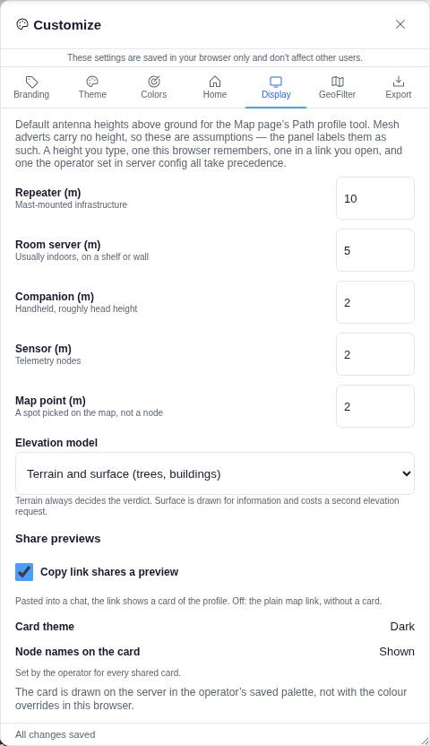
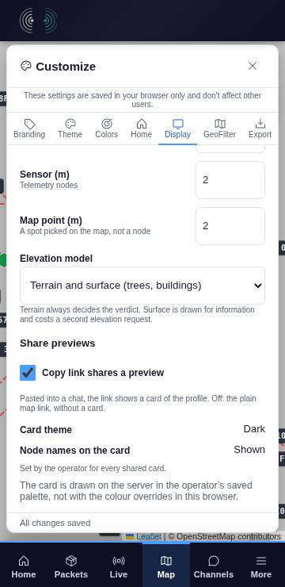
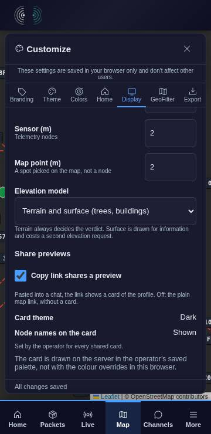

# Share previews for path profiles

When sharing is on, the Path profile's **Copy link** button on the Map hands
out a `/p?profile=…` link instead of `#/map?profile=…`. Pasted into Discord,
Facebook, Slack or a similar chat, that link shows a preview card of the
profile. Opened in a browser, it goes straight to the same profile on the Map.

Sharing is off by default (#727).

Node pages have share previews too, with their own switch on the server:
see [Share previews for node links](node-share-previews.md). So do packet
links: see [Packet links](#packet-links) below.

## What the card shows

The card is a 1200×630 PNG drawn on the server, `GET /api/terrain/profile.png`.
The `/p` page names it as its `og:image`. The card shows:

- both endpoints. A node is shown by name, and a free map point by its
  coordinates. With `card.names` set to `false`, nodes show as "Node A" and
  "Node B". A hidden, blacklisted or unpositioned node is never named: the
  profile treats it as "not found";
- the chart, drawn as in the panel: terrain, surface, line of sight and
  Fresnel zone;
- the verdict, in the panel's words;
- the antenna heights, with the "assumed" caveat where no one set them;
- the DHM CC BY 4.0 credit, which is always present.

The `/p` page itself carries a title such as *Path profile: 11.1 km ·
Clear*, a description with the two endpoints, `og:url` and `robots
noindex`.

Before the profile's elevations are cached, the card is **degraded**. It
shows the endpoints and the distance without a verdict, and crawlers fetch it
again within a minute.

## What it costs

- **Upstream (Dataforsyningen).** Only the card can go upstream, and only
  when the profile's elevations are not cached. Usually they are cached: a
  link is measured in a browser before it is shared, and that measurement
  caches the profile. A card fetch also takes a slot of `maxInFlight`, the
  same slots `GET /api/terrain/profile` uses. Upstream fetches caused by
  sharing are capped server-wide by `share.upstreamPerMin` (default 2 per
  minute; `0` means sharing never goes upstream). The cap applies whoever
  fetches the card, so a crawler fleet spread over many addresses cannot
  spend more. When the cap is spent, upstream fails, or upstream takes
  longer than 10 s, the card is served degraded (`Cache-Control:
  max-age=60`). A fetch that runs past those 10 s carries on to the
  profile's own deadline and is cached, so the next card is complete.
- **Server.** Drawing a card takes about 30–40 ms of CPU on a small VM, and
  a card is 47–95 KB. Rendered cards are cached for 24 h
  (`card.cacheEntries`, default 64, also bounded by bytes). A cached card
  costs nothing. A card that is not cached counts against the per-client
  `rateLimitPerMin`. A complete card is served `immutable` for a day.
- **`/p` itself** never goes upstream. It reads only what is already cached.

## Turning it off

- **Operator.** Set `map.dhm.profile.share.enabled` to `false` in
  `config.json` (the default) and restart. Copy link then hands out the plain
  `#/map?profile=…` link again, `/api/terrain/profile.png` answers 404, and
  `/p` serves the site's own preview. Existing `/p` links keep opening the
  profile either way. To keep previews but never spend upstream on them, set
  `share.upstreamPerMin` to `0`.
- **Viewer.** In the customizer, open **Display → Terrain Profile → Share
  previews** and turn off **Copy link shares a preview**. That browser's
  Copy link then hands out the plain map link. The same switch covers
  [node links](node-share-previews.md#turning-it-off). The setting is stored as
  `terrain.shareLinks` (only `false` is stored), goes into an export, and
  **Reset** removes it. It cannot turn previews on when the server has them
  off.

## The card's look

The card's look is set by the operator. It is drawn once for everyone who
sees the link:

- `map.dhm.profile.card.theme`: `dark` (the default, since previews mostly
  sit on dark chat backgrounds) or `light`;
- `map.dhm.profile.card.names`: `true` (the default) or `false`;
- the colours come from `theme.json` (`theme`/`themeDark`: `terrainFill`,
  `terrainClutter`, `losLine`, `fresnel100`, `fresnel60`, `profileBlocked`
  and the base colours). The server reads them at start, so a change shows
  after a restart.

The customizer shows the card theme and the names setting under Share
previews. The card uses the operator's saved palette, not the colour
overrides a viewer makes in their own browser.

## Packet links

A shared `#/packets/<hash>` link previews only as the site's own card,
because nothing after `#` reaches the server. When packet sharing is on,
**Copy link** on a packet's detail pane, on the standalone `#/packet/<id>`
page and in the **View Path** modal hands out a `/p?packet=<hash>` link
instead (View Path: `/p?packet=<hash>&viewPath=1`). Pasted into Discord,
Facebook, Slack or a similar chat, that link shows a card of the packet's
path. Opened in a browser, it goes straight to the packet page, or to the
packet page with the View Path modal open, and replaces the address with
`#/packets/<hash>` (or `#/packets/<hash>?viewPath=1`). No history entry is
left for `/p`, and only the hash is carried over.

Packet sharing is off by default (#812). It is the third card type, after
path profiles and node links, and uses the same `/p` route.

Copy link keeps the plain link when:

- an observation is selected (`?obs=<id>`): `/p` does not carry an
  observation, so the plain `#/packets/<hash>?obs=<id>` link keeps it;
- the packet has no 16-hex hash (`/p?packet=` takes the hash only, never a
  numeric id);
- the Ping scores page's View Path links (`#/ping-scores/…`): they show
  archived evidence, which the packet card does not draw.

### What the card shows

The card is a 1200×630 PNG drawn on the server,
`GET /api/packets/{hash}/card.png`. The `/p` page names it as its
`og:image`. The card shows:

- the firmware payload type, the route type and the hop count, for example
  *GRP_TXT · Flood · 6 hops*. Every payload type gets a card, direct-routed
  ones too;
- "First heard by <observer>" and how many observers heard it. The first
  observer goes through the same visibility rule as the path; when it is
  hidden, the card shows the count only, and no other observer is named in
  its place;
- the path as a schematic with no basemap: hop points and lines, the
  observers, and faint outlines of the configured areas it touched;
- the spread, the farthest observer from the first, and the estimated flood
  airtime (a lower bound, shown with "≥");
- when it was first heard, in UTC, and the site name.

With `map.dhm.profile.card.names` set to `false`, the card names no node or
observer. The `/p` page carries a title such as *GRP_TXT · Flood · 6 hops ·
heard by 12*, a description with the same values as text and the touched
area names, `og:url` built from the hash, and `robots noindex`.

### What is never shown

- **No message content, for any payload type.** No `GRP_TXT` message text
  (also when the server can decrypt it), no channel name (not even a
  hashtag channel's), no sender name taken from the text, and nothing of a
  `TXT_MSG`, `REQ`, `RESPONSE` or `ANON_REQ` payload. The card names the
  payload type only.
- **Only an `ADVERT` names its origin**, the advertising node. An advert
  from a hidden node (`nodeBlacklist`, `hiddenNamePrefixes`) has no card:
  `/p?packet=` answers with the site's own preview and a 404.
- **Nothing hidden.** A branch through a hidden node or observer
  (`nodeBlacklist`, `observerBlacklist`, `hiddenNamePrefixes`) is removed
  whole, approximate (neighbour-estimated) positions are left out while a
  visibility policy is active, and every count is computed from what is
  drawn, so no total gives a removed branch away.
- **No map tiles and no observer list.** The packet page still shows the
  observers to anyone who opens it.

When no station on the path has a visible position, the card shows the
type, route and counts without a schematic.

### What it costs

- **No upstream service.** A packet card reads the in-memory packet store
  and the database only. It needs no DHM token and works without `map.dhm`.
- **Server.** A card that is not cached costs one path query, the same one
  the packet's View Path uses, and one render: about 12–17 ms on a fast
  machine. A cached card costs well under a millisecond. Paths and cards
  are cached (64 entries each, also bounded by bytes): 2 minutes while the
  packet was first heard less than 10 minutes ago, because observations
  still arrive, and 24 hours after that. The card is served with
  `Cache-Control: public, max-age=120` or `public, max-age=86400` to match.
  A card that is not cached counts against the per-client
  `map.dhm.profile.rateLimitPerMin` (429 when spent) and is drawn in the
  same render slots as the other cards, so every card type shares one
  budget.
- **`/p?packet=` itself** uses the same cached path and never draws.
- A packet that has left both the store and the database (retention) has
  no card: `/p?packet=` answers with the site's own preview and a 404, and
  the link still opens the packets page.

### Turning it off

- **Operator.** `share.packets.enabled` in `config.json` is `false` by
  default. Set it to `true` to turn packet previews on, then restart. With
  it off, Copy link hands out the plain `#/packets/<hash>` link (View Path:
  `#/packets/<hash>?viewPath=1`), `/api/packets/{hash}/card.png` answers
  404, and `/p?packet=` serves the site's own preview. Existing `/p?packet=`
  links keep opening the packet page either way.
- **Viewer.** In the customizer, open **Display → Share previews** (inside
  **Terrain Profile** when the server has the Path profile tool) and turn off
  **Copy link shares a preview**. It is the same switch as for path profiles
  and node links; there is no packet-only switch. It is stored as
  `terrain.shareLinks` (only `false` is stored), and it cannot turn previews
  on when the server has them off.

`share.packets.enabled` and the card's look (`map.dhm.profile.card.theme`
and `.names`, the colours from `theme.json`) are server-only. The customizer
reports that packet links get a card and shows the card look, and stores
nothing for them.

The `og:image` URL holds the hash, which is already in the link, and `v=`, a
short content hash of what the card shows. `v` changes when an observation
arrives that changes the card. It holds no name or position.

## Privacy: what the image URL carries

The `og:image` URL holds the same endpoints and radio parameters as the
shared link. A node appears there by its key and a map point by its
coordinates, exactly as in the link. Its `v=` parameter is a short content
hash of how the card is drawn: the renderer, the palette and card options,
the nodes' names, resolved positions and antenna heights, the radio, and
whether the profile is ready. `v` changes
whenever the card would change, but it holds no node name or position. A
node's resolved position never appears in the URL.

## Chat services cache previews

Facebook, Discord and similar services keep a preview after they first fetch
it, and CoreScope cannot make them fetch it again:

- **Facebook** keeps the preview until someone asks the
  [Sharing Debugger](https://developers.facebook.com/tools/debug/) to scrape
  the link again.
- **Discord** caches link embeds and has no refresh tool. A message posted
  while the card was degraded can keep the degraded card.

A changed card gets a new `og:image` URL through `v`. A service only sees
that URL when it fetches the `/p` page again. Test with a fresh link. The
real Facebook and Discord crawlers need a publicly reachable host.
